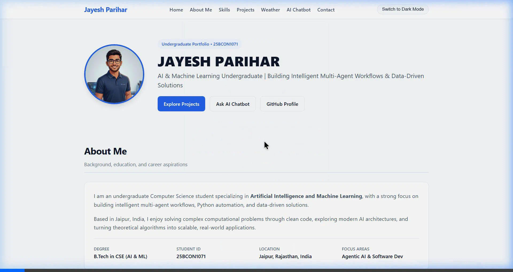
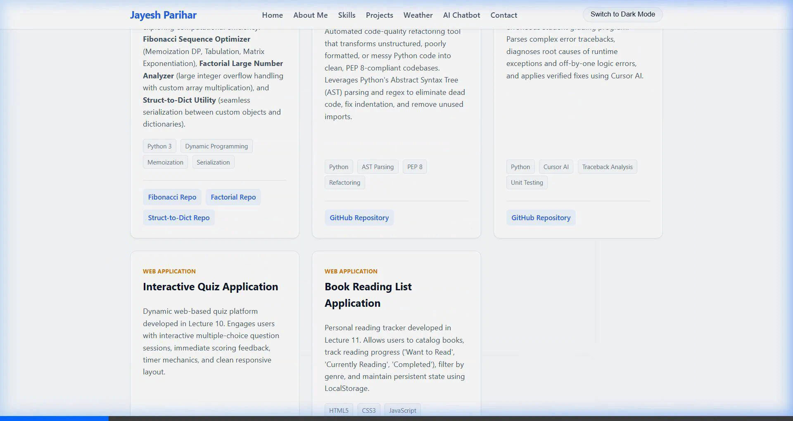
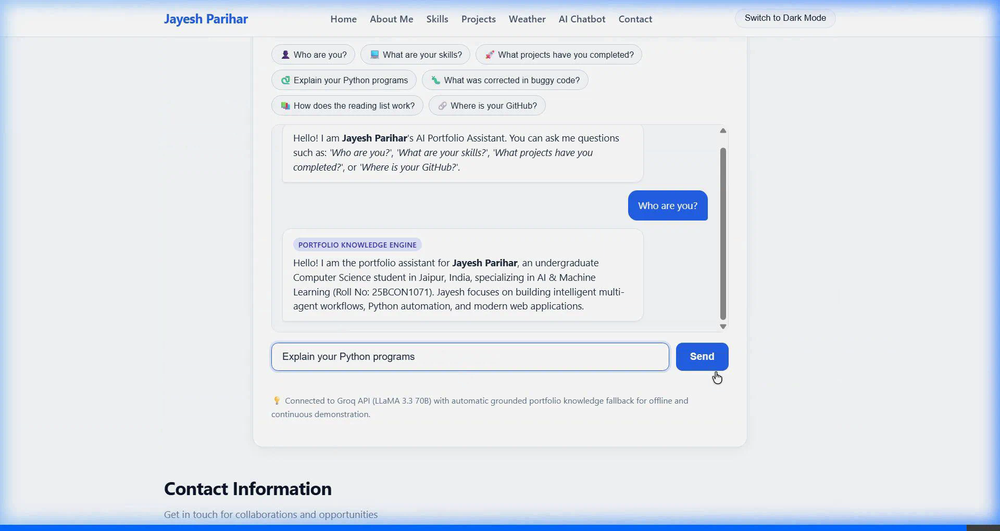
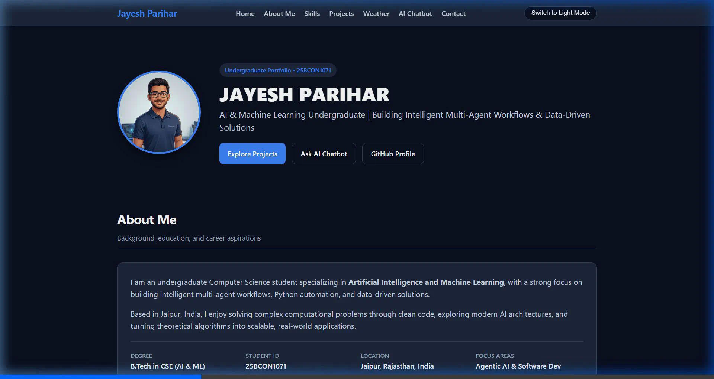

# Krishna Kanwar — Personal Portfolio Website with API-Based Chatbot Integration

[](https://portfolio-wexa.vercel.app/)
[](https://github.com/krishnakanwar-1347/portfolio)

A personalized, fully responsive portfolio website developed by **Krishna Kanwar** (Roll No: `25BCON1347`) for the **Internal Assessment Project**. The website showcases past GitHub projects, implements interactive real-time search & filter functionality, light/dark mode toggling, a live weather widget, and an AI-powered chatbot grounded in the student's portfolio information.

## 🚀 Live Website Link

**[https://portfolio-wexa.vercel.app/](https://portfolio-wexa.vercel.app/)**

---

## 📸 Portfolio Screenshots

### Screenshot 1: Hero & About Me Section


### Screenshot 2: Skills & Project Cards with Search and Filter


### Screenshot 3: Grounded AI Chatbot in Action


### Screenshot 4: Dark Mode Theme


---

## 🛠️ Technologies Used

- **Frontend:** HTML5 (Semantic Structure), Vanilla CSS3 (Custom Design System, Flexbox, CSS Grid), JavaScript (ES6+)
- **AI & Chatbot:** Groq API (`openai/gpt-oss-20b`), Vercel Serverless Functions (`/api/chat`), Grounded Local Knowledge Engine
- **APIs:** OpenWeatherMap API (Weather Integration)
- **Version Control & Hosting:** Git, GitHub, Vercel

---

## ✨ Implemented Features

### 1. Personalized Portfolio (Task 1)
- Full name, personal introduction, educational background (B.Tech CSE in AI & ML, Roll No: `25BCON1347`).
- Custom profile photograph ([profile.jpg](./profile.jpg)) and verified contact links (GitHub, Email, Location).
- Elimination of all placeholders and dummy information.

### 2. Showcase of 5 Required Projects (Task 2)
Displayed as structured, responsive project cards with descriptions, technology badges, working GitHub links, and live application links:
1. **Python Programs Collection:** Fibonacci Sequence Optimizer (DP Memoization & Tabulation), Factorial Large Number Analyzer, and Struct-to-Dict serialization utility.
   - [Fibonacci Repository](https://github.com/jayeshparihar08-max/python-basics-25BCON1347-fibonacci)
   - [Factorial Repository](https://github.com/jayeshparihar08-max/pyhton-basics-25BCON1347-factorial)
   - [Struct-to-Dict Repository](https://github.com/jayeshparihar08-max/python-basics-25BCON1347-struct-to-dict)
2. **Messy Python Code Improvement:** AST (Abstract Syntax Tree) parsing and regex-based code cleaner ensuring PEP 8 compliance.
   - [Messy Python Code Repository](https://github.com/jayeshparihar08-max/messy-python-code)
3. **Bug Fixing Using Cursor AI:** Diagnostic and bug-resolution assistant correcting syntax and logical flaws in student grading scripts.
   - [Bug Fixing Repository](https://github.com/jayeshparihar08-max/correcting-grade-25BCON1071-main)
4. **Interactive Quiz Application (Lecture 10):** Web-based quiz platform with interactive multiple-choice questions and real-time score tracking.
   - [Quiz GitHub Repository](https://github.com/jayeshparihar08-max/QUIZ)
   - [Live Quiz Application](https://quiz-wexa.vercel.app)
5. **Book Reading List Application (Lecture 11):** Digital bookshelf with status tracking ('Want to Read', 'Currently Reading', 'Completed') and LocalStorage persistence.
   - [Reading List GitHub Repository](https://github.com/jayeshparihar08-max/reading_list)
   - [Live Reading List Application](https://reading-list-teal-zeta.vercel.app/)

### 3. Interactive Project Search & Category Filter (Task 3 - Mandatory)
- **Real-Time Search:** Visitors can search projects by title, description, or technology (e.g., `"Python"`, `"Quiz"`, `"Book"`, `"Algorithms"`).
- **Category Filter Pills:** Quick filters for `All Projects`, `Python`, `Web Apps`, and `AI & Debugging`.
- **Dynamic Count:** Shows exact number of matching projects with clear empty-state feedback.
- **Theme Toggle:** Switch seamlessly between Light Mode and Dark Mode with persistent local storage.

### 4. API-Based Grounded Portfolio Chatbot (Task 6)
- **Grounded Responses:** Answers questions grounded in Krishna's background, skills, and the 5 completed projects.
- **Example Prompts Supported:**
  - *Who are you?*
  - *What are your skills?*
  - *What projects have you completed?*
  - *Explain your Python programs.*
  - *What was corrected in the buggy code project?*
  - *How does the reading list work?*
  - *Where is your GitHub?*
- **Quick-Prompt Chips:** Clickable question chips for instant testing.
- **Dual Connection Architecture:**
  - **Live Groq API (`openai/gpt-oss-20b`):** Directly configured in `config.js` and securely forwarded via `/api/chat` Vercel Serverless Function.
  - **In-App Key Configuration:** An optional **"⚙️ Set API Key"** button lets users or examiners enter an API key stored safely in browser `localStorage`.
  - **Grounded Offline Knowledge Engine:** If offline, without an API key, or upon rate-limiting, the chatbot gracefully answers all portfolio questions accurately without failing.

### 5. Weather Widget (Lecture 9 Integration)
- Live city weather lookup using OpenWeatherMap API, displaying temperature, weather condition, humidity, and wind speed.

---

## 💻 Setup and Local Running Instructions

1. **Clone the repository:**
   ```bash
   git clone https://github.com/krishnakanwar-1347/portfolio.git
   cd portfolio
   ```

2. **Open the project:**
   - Double-click `index.html` to open it in any modern web browser, or serve it using a local static server:
     ```bash
     python -m http.server 5173
     ```
   - Open `http://localhost:5173` in your browser.

---

## 🌐 Vercel Deployment

1. Connect the GitHub repository to [Vercel](https://vercel.com).
2. (Optional) In Vercel Project Settings &rarr; **Environment Variables**, add:
   - `GROQ_API_KEY` = your Groq API key (`gsk_...`)
   - `GROQ_MODEL` = `openai/gpt-oss-20b`
3. Deploy! Vercel automatically hosts the frontend and the `/api/chat` serverless function.

---

## 👤 Author

- **Name:** Krishna Kanwar
- **Roll Number:** 25BCON1347
- **GitHub:** [@krishnakanwar-1347](https://github.com/krishnakanwar-1347)
- **Email:** [krishnakanwar1347@gmail.com](mailto:krishnakanwar1347@gmail.com)
